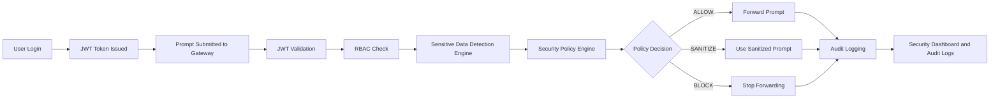

# Component 03: Security Policy & Access Control Engine

## Owner

Sanduni - Member 3

## Component Overview

The Security Policy & Access Control Engine is responsible for deciding whether an inspected prompt is allowed to continue to the AI provider, must be sanitized before forwarding, or must be blocked. This component works after the Sensitive Data Detection Engine and before the gateway forwards any prompt to Ollama or another AI service. Its main purpose is to protect confidentiality by enforcing authentication, role-based access control, and policy decisions on prompts that may contain sensitive information.

The component receives the authenticated user context, the prompt inspection result from Component 1, and forwarding settings from the gateway. It then applies policy rules and returns one of three decisions:

- `ALLOW` - the prompt does not contain sensitive data and can be forwarded by an authorized user.
- `SANITIZE` - the prompt contains sensitive data that may continue only after masking.
- `BLOCK` - the prompt contains high-risk credential material or the user role is not permitted to submit prompts.

All decisions are passed to the Audit Logging component so administrators can review who submitted a prompt, which policy rule was triggered, and what action was enforced. The audit record stores masked output and metadata, not raw secrets.

## Methodology

The component was implemented using an incremental security-by-design approach:

1. Define the required access roles and policy actions.
2. Integrate JWT-authenticated user context into policy evaluation.
3. Use Component 1 detection results as the policy input.
4. Create deterministic rules for `ALLOW`, `SANITIZE`, and `BLOCK`.
5. Store policy decisions in the audit log for evidence and traceability.
6. Add unit and integration tests to confirm enforcement behavior.

This approach keeps the policy engine separate from the detection engine, which makes future rule changes easier without rewriting the sensitive data detection logic.

## Technical Flow

## Implemented Rules

| Rule ID | Rule Name | Action | Purpose |
| --- | --- | --- | --- |
| `POL-RBAC-001` | Only admin and user roles can process prompts | `BLOCK` | Prevent read-only auditor accounts from sending prompts to AI providers. |
| `POL-CRED-001` | Block credential and secret exposure | `BLOCK` | Stop passwords, API keys, tokens, private keys, and similar secret material from being forwarded. |
| `POL-PCI-001` | Sanitize payment card data | `SANITIZE` | Mask payment or financial data before any forwarding decision. |
| `POL-PII-001` | Sanitize personal data | `SANITIZE` | Mask email addresses, phone numbers, and other personal data. |
| `POL-SRC-001` | Sanitize proprietary source code | `SANITIZE` | Protect source code and internal intellectual property. |
| `POL-ALLOW-001` | Allow low risk prompt | `ALLOW` | Permit safe prompts from authenticated admin or user accounts. |

## Inputs

- Authenticated user identity from JWT validation.
- User role: `admin`, `auditor`, or `user`.
- Prompt detection result from Component 1.
- Sanitized prompt from the gateway masking stage.
- AI service/provider name.
- Forwarding request flag.

## Outputs

- Policy decision: `ALLOW`, `SANITIZE`, or `BLOCK`.
- Matched policy rule ID and rule name.
- Reason for the decision.
- Sanitization requirement.
- Forwarding permission.
- Recommendation for the user or administrator.
- Audit event forwarded to Component 4.

## Functional Requirements

| ID | Requirement |
| --- | --- |
| FR-C3-01 | The system shall validate JWT tokens before prompt processing endpoints are used. |
| FR-C3-02 | The system shall enforce role-based access control for admin, auditor, and user roles. |
| FR-C3-03 | The system shall prevent auditor accounts from submitting prompts to AI providers. |
| FR-C3-04 | The system shall evaluate Component 1 detection results before any forwarding decision. |
| FR-C3-05 | The system shall return a clear policy decision of `ALLOW`, `SANITIZE`, or `BLOCK`. |
| FR-C3-06 | The system shall block prompts containing credentials, passwords, API keys, private keys, or secret tokens. |
| FR-C3-07 | The system shall require sanitization for PII, financial data, and source code findings. |
| FR-C3-08 | The system shall forward policy decisions and rule metadata to the Audit Logging component. |
| FR-C3-09 | The system shall expose current policies through the backend policies endpoint for dashboard display. |
| FR-C3-10 | The system shall avoid storing raw sensitive prompt values in audit outputs. |

## Non-Functional Requirements

| ID | Requirement |
| --- | --- |
| NFR-C3-01 | Policy evaluation should complete quickly enough for real-time prompt inspection. |
| NFR-C3-02 | Policy logic should be deterministic so decisions can be tested and explained. |
| NFR-C3-03 | The component should be maintainable through isolated policy engine code. |
| NFR-C3-04 | Policy decisions should be auditable with rule IDs and human-readable reasons. |
| NFR-C3-05 | The component should support future policy expansion without changing the detection engine. |
| NFR-C3-06 | The component should follow least privilege by restricting prompt processing by role. |
| NFR-C3-07 | The component should minimize retained sensitive data by relying on masked audit records. |

## Best Practices and Standards

- ISO/IEC 27001: The component supports access control, confidentiality, auditability, and risk treatment by enforcing role-based decisions before prompts leave the local gateway.
- GDPR: The component supports privacy by design and data minimisation by requiring masking for personal data and avoiding raw sensitive values in audit evidence.
- PCI DSS v4.x: The component supports payment data protection by sanitizing financial data, restricting access by role, identifying authenticated users, and preserving audit logs for security review.
- Least privilege: Auditors can read audit evidence but cannot submit prompts to external AI providers.
- Defense in depth: The policy engine does not replace detection or sanitization; it enforces decisions using their outputs.

## Testing

Unit tests cover the policy engine rules:

- Clean prompt from an authorized user returns `ALLOW`.
- Auditor prompt submission returns `BLOCK`.
- API key or credential material returns `BLOCK`.
- Email/PII findings return `SANITIZE`.
- User forwarding preference is respected after sanitization.

Integration tests cover the full FastAPI gateway path:

- Register and authenticate a user.
- Submit a prompt containing an API key and email address.
- Confirm sensitive values are masked.
- Confirm the policy decision is `BLOCK`.
- Confirm audit logs store the matched policy rule.
- Confirm CSV export does not contain the raw secret.

## Development Progress

| Date | Progress |
| --- | --- |
| 2026-09-18 | Created the Component 3 policy engine structure and policy decision models. |
| 2026-09-18 | Integrated policy evaluation into the FastAPI prompt gateway. |
| 2026-09-18 | Added audit log metadata for matched policy rules and enforcement status. |
| 2026-09-18 | Added unit and integration tests for policy decisions. |
| 2026-09-18 | Prepared documentation for requirements, technical flow, standards, and testing. |

## References

- ISO/IEC 27001 information security management systems: https://www.iso.org/standard/27001
- ISO access control overview: https://www.iso.org/information-security/access-control
- GDPR Article 25, data protection by design and by default: https://gdpr-info.eu/art-25-gdpr/
- European Data Protection Board guidance on data protection by design and by default: https://www.edpb.europa.eu/
- PCI Security Standards Council official site: https://www.pcisecuritystandards.org/
- PCI DSS v4.x document library: https://www.pcisecuritystandards.org/document_library/
